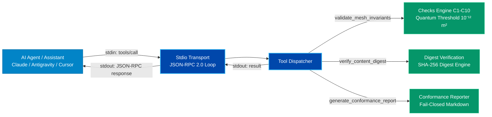

# System Architecture: nain-mcp-validator

## 1. Architectural Blueprint



## 2. Directory Layout

```text
nain-mcp-validator/
├── docs/                # Spec-driven numbered lifecycle documentation
├── src/
│   └── nain_mcp_validator/
│       ├── __init__.py
│       ├── server.py    # MCP stdio JSON-RPC server loop
│       └── domain/
│           ├── checks.py   # Deterministic topological checks C1 to C10
│           ├── digest.py   # Content-addressing SHA-256 verifier
│           └── reporter.py # Markdown audit reporter
├── tests/
│   ├── test_checks.py
│   ├── test_digest.py
│   └── test_server.py
├── pyproject.toml
└── README.md
```
