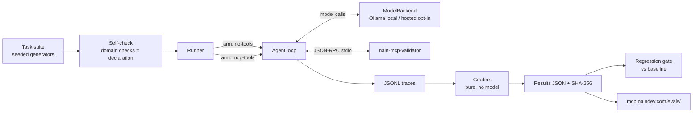

# Plan: agent eval harness

## Modules

| Module | Responsibility | Covers |
| :--- | :--- | :--- |
| `evals/tasks.py` | Task dataclass and the suite registry | REQ-EVAL-01 |
| `evals/mesh_gen.py` | Seeded generators for clean and defective meshes (one per check) | REQ-EVAL-01, 02 |
| `evals/selfcheck.py` | Runs the domain checks on every task and compares with the declaration | REQ-EVAL-02 |
| `evals/mcp_client.py` | Spawns the server and speaks JSON-RPC over stdio | REQ-EVAL-03 |
| `evals/backends.py` | `ModelBackend` protocol, `OllamaBackend`, `ScriptedBackend` (tests), hosted opt-in | REQ-EVAL-03, 11 |
| `evals/agent.py` | Agent loop for both arms with a step limit | REQ-EVAL-03, 04, 07 |
| `evals/trace.py` | JSONL trace writer | REQ-EVAL-05 |
| `evals/graders.py` | Pure grading functions | REQ-EVAL-06 |
| `evals/results.py` | Aggregation, canonical JSON, SHA-256 | REQ-EVAL-08 |
| `evals/gate.py` | Baseline comparison | REQ-EVAL-09 |
| `site/evals.ts` or Python generator | Results table and trace viewer | REQ-EVAL-10 |

Layer rule: graders, results and gate are pure functions with no I/O. The runner and client are the only code that spawns processes or opens sockets.

## Key decisions and discarded alternatives

- **Oracle instead of LLM judge** (ADR-0003). Discarded: a judge model, because it adds the same unreliability the harness measures.
- **Domain-agnostic core, 3D suite first** (ADR-0001). Discarded: 3D-only code, because the playable domain is next.
- **Local model by default** (ADR-0002). Discarded: hosted only, because of cost and reproducibility.
- **Same repository, `/evals/` path** (ADR-0004). Discarded: a new repository and subdomain, because the data and the server belong together.

## Test strategy

- Pure graders and gate: table tests, including the two failing cases.
- Self-check: a deliberately wrong declaration must fail.
- Runner and client: a fake server script and `ScriptedBackend`, so no model is needed.
- Site generator: renders a fixture results file, fails on an invalid one.
- Live model run: manual task, results committed as the baseline.

## Risks

- A local model may call tools unreliably. The first live run measures it, and the result is published as it is.
- Synthetic meshes may not cover every check. Missing coverage is listed in the results page.
